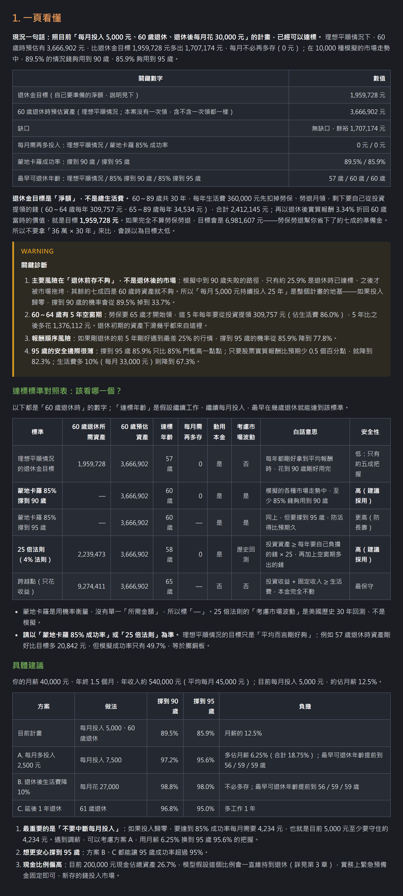
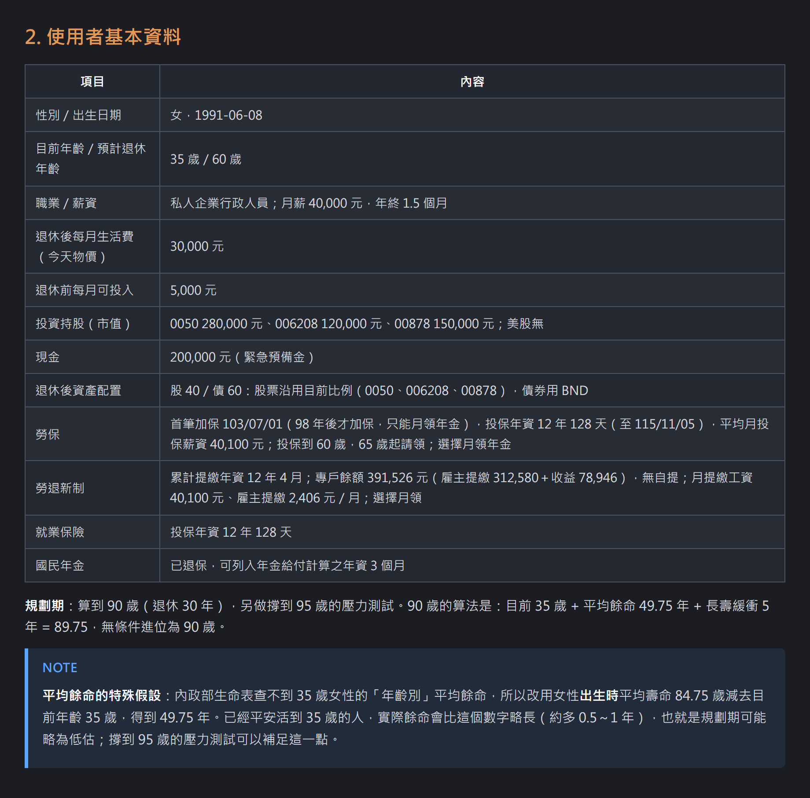
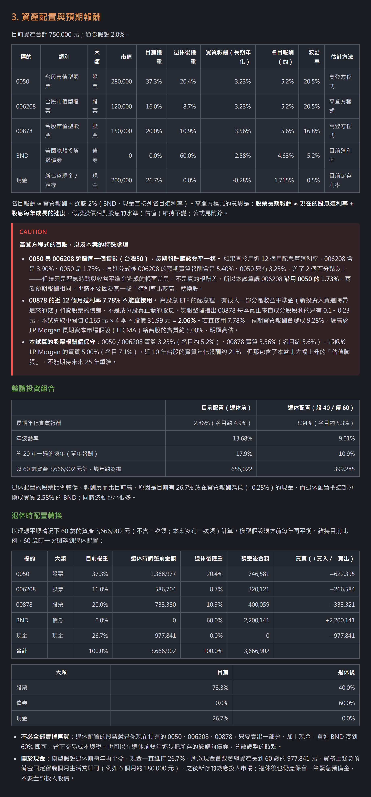
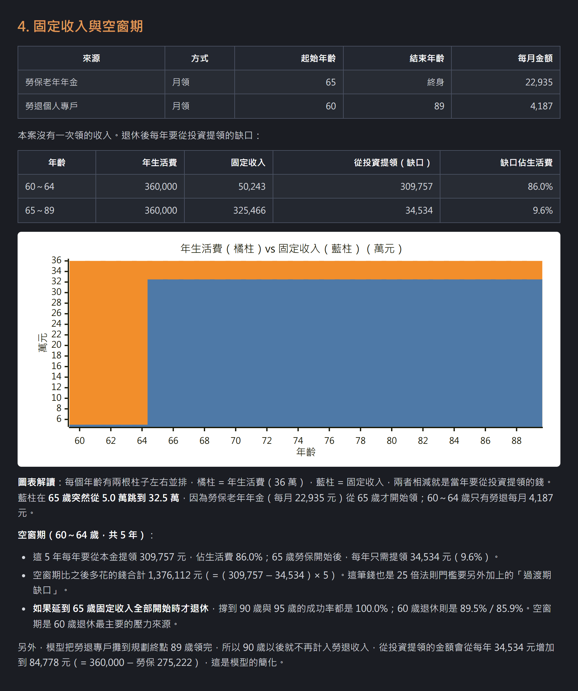
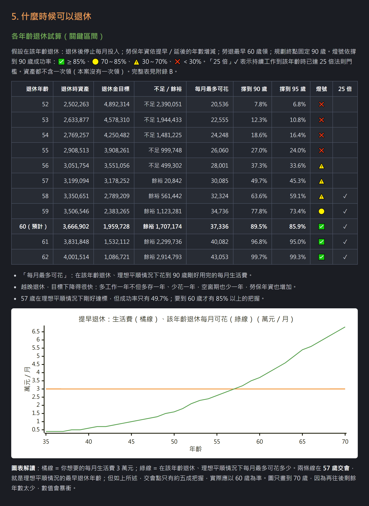
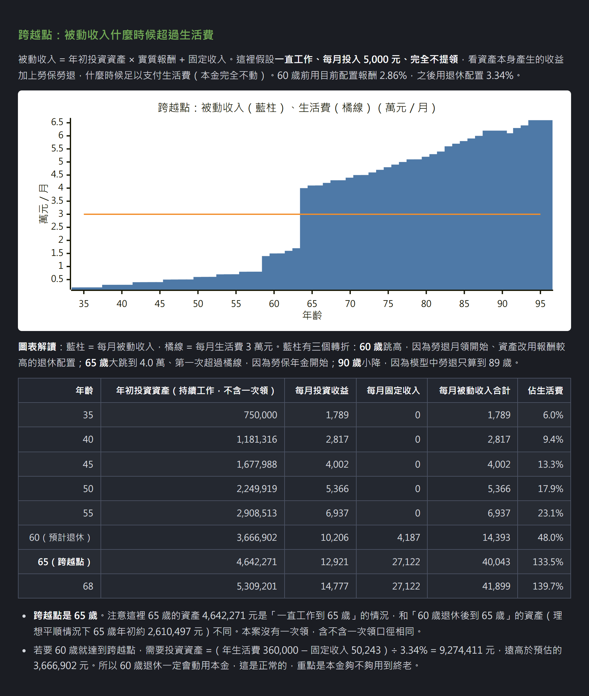
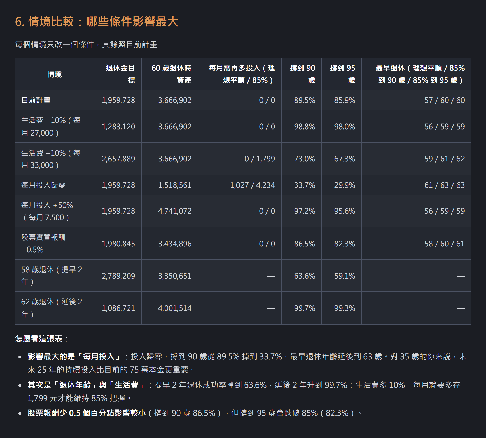
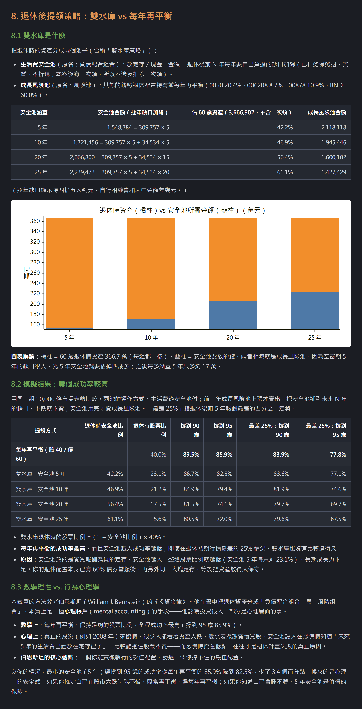
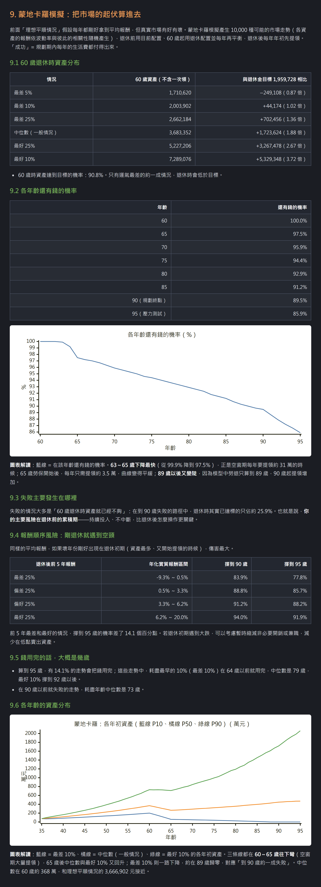
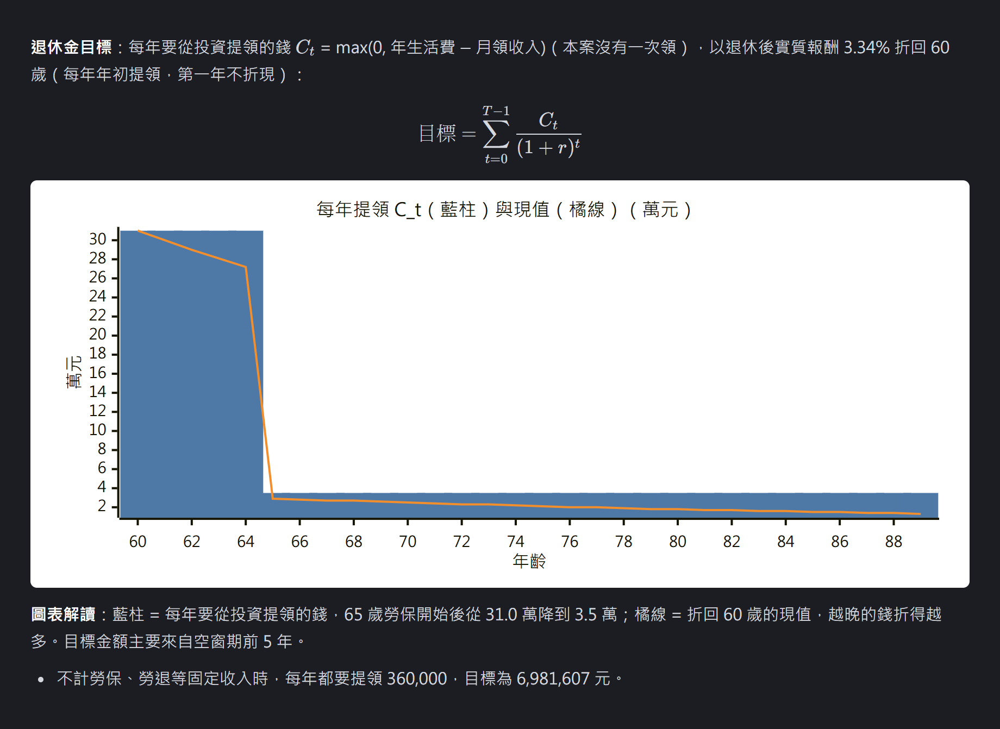

# retirement-target

Claude Code skill：計算退休金目標、預估退休時資產、退休缺口與每月需再多存多少（台灣制度、新台幣）。

輸入你的年齡、預計退休年齡、退休後每月生活費、目前持股與現金、每月可投入金額，以及勞保／勞退（或公保／退撫）狀況，skill 會自動上網抓取市場歷史波動率、相關係數、配息殖利率、通膨率、內政部簡易生命表平均餘命、定存利率與最新勞保勞退級距，透過**確定性年金現值公式**與 **10,000 次蒙地卡羅模擬**算出結果，並產出**一般人看得懂的最終報告**與**含完整算式的計算底稿**。

> [!IMPORTANT]
> 所有金額皆以**「今天的購買力」（扣除通膨後的實質新台幣）**計算與呈現，避免把數十年後膨脹的名目數字誤認為實際購買力。

---

## 核心特色與功能

1. **網路查得到的資料不問使用者（含本機快取）**
   - 台股（Fugle API → yfinance `.TW` → `.TWO`）與海外標的（yfinance → Yahoo Chart API）自動抓取近 10 年還原權值月報酬，計算年化波動率、相關係數矩陣與近 12 個月配息殖利率（`div_yield_ttm`），並自動扣除美國掛牌股票 ETF 的 30% 股利預扣稅拖累（`drag`）。
   - 自動查詢主計總處 CPI 近 20 年通膨率、內政部簡易生命表年齡別平均餘命、臺灣銀行一年期定存利率、債券 ETF 30 日 SEC yield、J.P. Morgan 長期資本市場假設（LTCMA）與當年勞保／勞退分級表。
2. **完整支援台灣退休制度與多元現金流**
   - **勞保**：支援老年年金月領（A／B 兩式擇優、提前或延後請領增減 ±4%）、98 年前有年資者之舊制一次請領老年給付，以及未滿 15 年之老年一次金。
   - **勞退新制**：支援個人專戶累積試算（雇主 6%＋自提 0～6%），退休後可選月領（攤提至規劃終點）或一次領存入投資組合。
   - **其他固定收入與一次性收入**：支援公保／退撫新制、房租、年金險等定期現金流，以及儲蓄險到期領回、資產出售等**一次性收入（`lump: true`）**，並清楚標示勞保起領前的**空窗期（過渡期缺口）**。
3. **五種退休達標標準同表對照**
   - 同時評估：**理想平順情況（確定性目標）**、**蒙地卡羅 85% 撐到規劃終點（如 90 歲）**、**蒙地卡羅 85% 撐到 95 歲（長壽壓力測試）**、**25 倍法則（4% 法則，含空窗期過渡缺口修正）**，以及**跨越點（被動收入 ≥ 生活費，不動用本金）**。
4. **各年齡退休試算與情境敏感度分析**
   - 逐年列出不同年齡退休的預估資產、退休金目標、不足／餘裕、每月最多可花金額、90／95 歲成功率、安全燈號（✅🟡⚠️❌）與是否達 25 倍門檻。
   - 自動比較生活費 ±10%、每月投入歸零／+50%、股票實質報酬 −0.5%、提早／延後 2 年退休等情境，找出最關鍵的風險因子並給出具體改善方案（含佔月薪負擔比例）。
5. **兩階段報告產出（計算底稿 ＋ 白話最終報告）**
   - `calc.py` 先產出包含完整公式、代入值與逐年明細的**計算底稿**（`retirement_report_YYYYMMDD_raw.md`）與**結構化數據檔**（`retirement_result_YYYYMMDD.json`）。
   - 再由 Subagent 依 `final_report_guide.md` 改寫成**沒有財經背景也看得懂的最終報告**（`retirement_report_YYYYMMDD.md`），主動提醒高登方程式盲點（如 0050／006208 同指數配息時點差異、00878 等高股息 ETF 含平準金與資本利得配息不可直接套用）與退休配置轉換建議。

---

## 方法出處

本 skill 的方法大量參考威廉．伯恩斯坦（William J. Bernstein）的《投資金律》（*The Four Pillars of Investing*），例如：

- **股票預期報酬用高登方程式估「基本報酬率」**（起始股息殖利率＋實質股息成長率 1.5% − 稅費拖累），不把過去本益比膨脹的「投機報酬」當成未來常態；J.P. Morgan LTCMA 與近 10 年歷史報酬僅列在報告中作為對照。
- **考慮投資組合的「波動拖累」（Volatility Drag）**：長期複利實質幾何報酬 $r = \exp(\ln(1+E) - \sigma_p^2/2) - 1$，反映波動越大對長期複利與提領的耗損。
- **雙水庫策略（生活費安全池＋成長風險池）**：把退休後前 $N$ 年（5、10、20、25 年）需自行負擔的生活費缺口放進獨立定存／現金安全池（書中稱「負債配合組合」），其餘留在「成長風險池」照退休配置持有。

但並非完全照書：另外加入台灣的勞保、勞退與公保規則、10,000 次蒙地卡羅模擬，並用同一組市場走勢實際比較「雙水庫策略」與「每年再平衡」在全程及退休前 5 年最差 25% 行情下的成功率，同時從**數學理性 vs. 行為心理學（心理帳戶）**角度協助使用者依自身風險承受度選擇。試算結果是本 skill 自己的計算，不代表原書作者的看法。

---

## 範例結果

以下是以 `examples/個人資料_小資上班族.txt`（35 歲女性行政人員、月薪 4 萬、目前資產 75 萬、每月投入 5,000 元、預計 60 歲退休後每月花 3 萬元）實際產生的 `retirement_report_20261106_小資上班族.md` 報告節錄：

### 1. 一頁看懂：現況結論、關鍵診斷、達標標準對照表與具體建議

報告開頭直接給出結論、4 點關鍵風險診斷、5 種達標標準對照，以及依月薪評估負擔的具體改善方案：



### 2. 使用者基本資料

skill 從使用者輸入整理出的個人現況、勞保勞退年資與請領條件、規劃期（平均餘命＋5 年長壽緩衝）說明：



### 3. 資產配置與預期報酬（含高登方程式盲點診斷與退休配置轉換）

股票以高登方程式、債券與現金以目前殖利率換算扣除通膨後的實質報酬，主動提醒高股息 ETF 與同指數 ETF 的殖利率盲點，並列出退休時的具體買賣調整金額：



### 4. 固定收入與空窗期

呈現勞保（65 歲起終身月領）與勞退（60～89 歲月領）開始時間差造成的 **60～64 歲 5 年空窗期**，以並排長條圖對照每年生活費與固定收入：



### 5. 什麼時候可以退休：各年齡退休試算與跨越點

逐年試算各年齡退休的資產、目標、每月最多可花金額、90／95 歲成功率與燈號（✅🟡⚠️❌），並標出被動收入超過生活費的**跨越點**：





### 6. 情境比較：哪些條件影響最大

單獨調整生活費 ±10%、每月投入歸零／+50%、股票實質報酬 −0.5%、提早／延後 2 年退休，一眼看出哪些因素對成功率影響最劇烈：



### 7. 退休後提領策略：雙水庫 vs 每年再平衡

計算 5、10、20、25 年生活費安全池所需金額，比較「每年再平衡」與「雙水庫策略」在 10,000 條市場走勢（含退休初期最差 25% 行情）下的成功率，並探討數學理性與行為心理學的取捨：



### 8. 蒙地卡羅模擬：存活機率、報酬順序風險與各年齡資產分布

模擬 10,000 種市場走勢，分析 60 歲退休時資產分位數、各年齡還有錢的機率曲線、失敗原因歸因、退休前 5 年遇到空頭的報酬順序風險，以及 P10／P50／P90 各年齡資產軌跡：



### 9. 附錄：退休金目標逐年提領與折現明細

附錄完整列出所有公式、各資產報酬與 J.P. Morgan LTCMA／近 10 年歷史報酬對照、勞保老年年金兩式擇優、勞退專戶累積表，以及每年從投資組合提領金額 $C_t$ 與折現值：



---

## 安裝

1. 將本 repo clone 下來，在 repo 根目錄啟動 Claude Code（skill 位於 `.claude/skills/retirement-target`）。
2. （選用）複製 `.env.sample` 為 `.env` 並填入 `FUGLE_API_KEY`，用於抓取台股還原權值月 K；未設定時會自動跳過 Fugle 並改用 yfinance。
3. 安裝 Python 環境（二選一）：
   - **推薦使用 [uv](https://docs.astral.sh/uv/)**：腳本已內建 PEP 723 相依套件宣告，執行 `uv run` 時會自動安裝所需套件（`numpy`、`pandas`、`requests`、`yfinance`、`fugle-marketdata`），無須手動建立虛擬環境。
   - **使用 `pip`**：`pip install numpy pandas requests yfinance fugle-marketdata pytest`

---

## 使用

在 Claude Code 中輸入「算退休金」「退休試算」「我要存多少才能退休」等，或直接提供個人資料檔。

範本請見 `examples/`：

- `examples/個人資料_小資上班族.txt`：私人企業上班族（勞保＋勞退新制）
- `examples/個人資料_公務員.txt`：公務人員（公保＋退撫新制＋一次性養老給付）

勞保投保年資、平均月投保薪資、勞退個人專戶累積金額等資料，可登入[勞保局 e 化服務系統](https://edesk.bli.gov.tw/)查詢，再照範本格式貼上即可。

試算完成後會在工作目錄產生：

- `retirement_report_YYYYMMDD.md`：**最終報告**（白話解讀、關鍵診斷、達標標準對照與改善方案，第一章「一頁看懂」即可掌握全貌）
- `retirement_report_YYYYMMDD_raw.md`：**計算底稿**（第 0～12 節完整數據、公式代入值與逐年明細，供驗算核對）
- `retirement_result_YYYYMMDD.json`：**結構化數據檔**（與底稿同步的完整試算結果與圖表數列）
- `retirement_input.json`：**試算輸入檔**（可修改參數後單獨重跑 `calc.py` 比較不同情境）

> [!TIP]
> 報告內的圖表使用 Mermaid `xychart-beta` 語法繪製，可在 GitHub、Typora 或 VS Code（安裝 *Markdown Preview Mermaid Support* 擴充功能）中直接預覽。

---

## 結構與快取機制

```text
.claude/skills/retirement-target/
├── SKILL.md                        # skill 完整五步驟流程說明
├── reference/
│   ├── input_schema.md             # calc.py 輸入 JSON 欄位格式
│   ├── defaults.md                 # 預期報酬算法、JPM LTCMA 對照表、預扣稅拖累、勞保勞退規則
│   └── final_report_guide.md       # 最終報告改寫指引（供步驟 4 subagent 使用）
└── scripts/
    ├── fetch_market.py             # 抓取市場歷史報酬、波動率、相關係數與配息殖利率
    ├── calc.py                     # 確定性公式、蒙地卡羅模擬、產生計算底稿與數據檔
    └── test_calc.py                # 單元測試（uv run --with pytest pytest）
```

抓到的市場資料與網路查到的數值會快取在專案目錄的 `.cache/retirement-target/`（已加入 `.gitignore`，不進版控）：

- `.cache/retirement-target/market/`：`fetch_market.py` 自動管理，各標的月收盤與配息殖利率在同一個月內重跑直接讀快取，匯率當天有效；加上 `--refresh` 參數可強制重抓。
- `.cache/retirement-target/web_lookups.json`：通膨率、簡易生命表平均餘命、台銀定存利率、債券 SEC yield、J.P. Morgan LTCMA、勞保勞退規則等依各項資料的更新週期設定到期日，到期才重新上網查。若要全部強制重抓，刪除 `.cache/retirement-target/` 資料夾即可。
